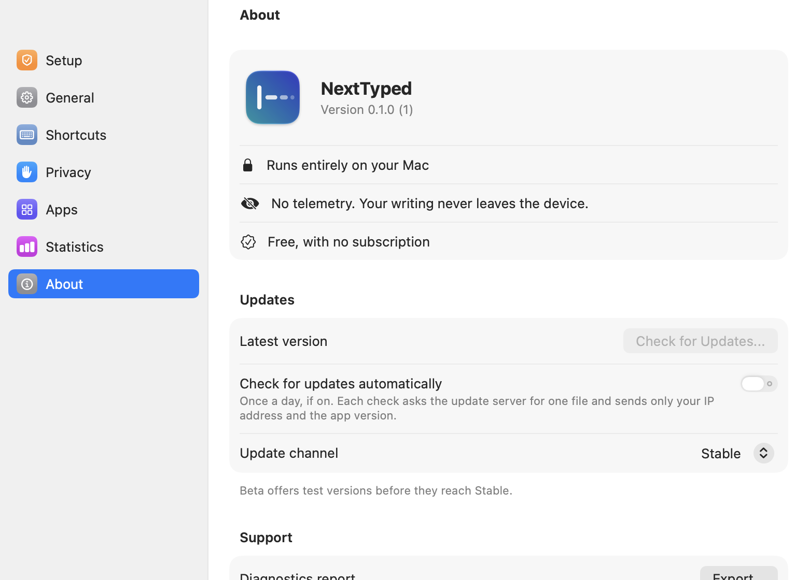
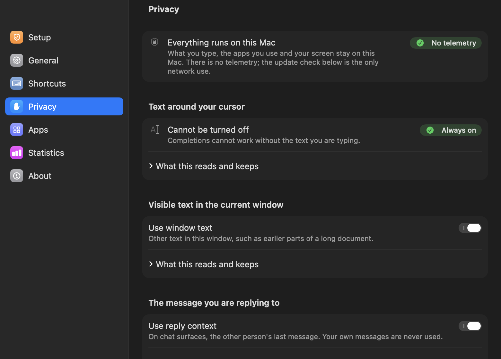

# NextTyped



NextTyped is a menu bar app for the Mac. While you type, it shows grey text at the cursor that predicts the next few words. It works in any app that shares its text through the macOS Accessibility API.

- `Tab` inserts one word.
- `⌥Tab` inserts the whole suggestion.
- `Esc` dismisses it.

A language model runs on the Mac through Apple MLX. Nothing you type leaves the machine, and the app sends no telemetry. Nothing is inserted until you press `Tab` or `⌥Tab`.

## Where it works

| App | State |
| --- | --- |
| TextEdit, multi-line form fields in Safari | works, ghost text at the cursor |
| Apple Notes, claude.ai in Safari, Claude Desktop | works, sized from the line height, a bubble below the line when the text wraps |
| Terminals | off by default, because the shell uses `Tab`. Can be switched on per app |
| Mail, compose body | does not work, Mail shares no text |
| Chrome, Word and every other app | not tested |

Every row has its evidence and date in [docs/compatibility.md](docs/compatibility.md).



## Limits

- German suggestions are wrong more often than English ones, or read like literal translations. The model has a few billion parameters. German suggestions can be switched off in Settings.
- Paragraphs with Hebrew, Arabic or other right-to-left text get no suggestion.
- The app is not notarized. There is no ready-made download, only the source code.

## Layout

- `NextTypedCore/` holds the logic without AppKit, as a Swift package with 1579 tests.
- `App/` is the macOS app: event tap, Accessibility, overlay, SwiftUI settings and the MLX model.
- `project.yml` describes the Xcode project for XcodeGen.

The central piece is `SuggestionSession` in `NextTypedCore/Sources/NextTypedCore/Session/`. It receives every event (key, caret move, model result) and returns what the app should do. Because it executes nothing itself, every rule can be tested without a running app.

## Build

You need an Apple silicon Mac with macOS 14 or later, full Xcode and XcodeGen (`brew install xcodegen`).

```bash
cd NextTypedCore && swift test
```

```bash
xcodegen generate && open NextTyped.xcodeproj
```

On first launch the app asks for the Accessibility permission. It then downloads the model [Qwen3.5-4B-Base](https://huggingface.co/Robin1333k/Qwen3.5-4B-Base-MLX-6bit) from Hugging Face, about 3.2 GB.

### Local signing

macOS keeps the Accessibility grant per code signature. So that it survives every rebuild, the project signs with a self-signed certificate named `NextTyped Dev` in your login keychain. If `security find-identity -p codesigning` does not list it, create it once:

```bash
cat > /tmp/nt.cnf <<'EOF'
[req]
distinguished_name = dn
x509_extensions = v3
prompt = no
[dn]
CN = NextTyped Dev
[v3]
keyUsage = critical, digitalSignature
extendedKeyUsage = critical, codeSigning
basicConstraints = critical, CA:false
EOF
openssl req -x509 -newkey rsa:2048 -nodes -keyout /tmp/nt.key -out /tmp/nt.crt -days 3650 -config /tmp/nt.cnf -extensions v3
/usr/bin/openssl pkcs12 -export -inkey /tmp/nt.key -in /tmp/nt.crt -out /tmp/nt.p12 -passout pass:ntdev -name "NextTyped Dev"
security import /tmp/nt.p12 -k ~/Library/Keychains/login.keychain-db -P ntdev -T /usr/bin/codesign -A
```

To remove the app and everything it leaves behind, see [docs/uninstall.md](docs/uninstall.md).

## Credits

Robin Klotz designed NextTyped and built it with Claude Code as the programming tool. License: [MIT](LICENSE).
